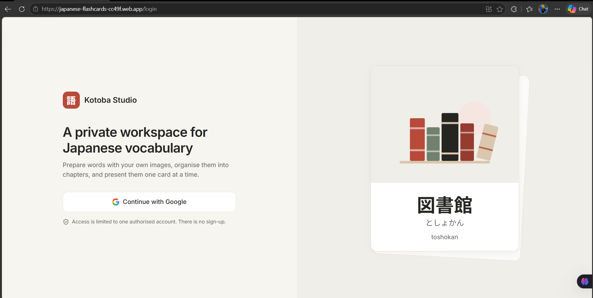
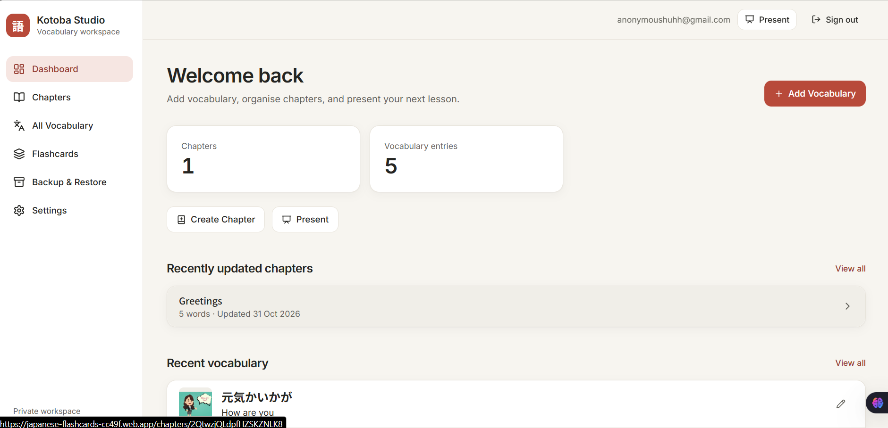
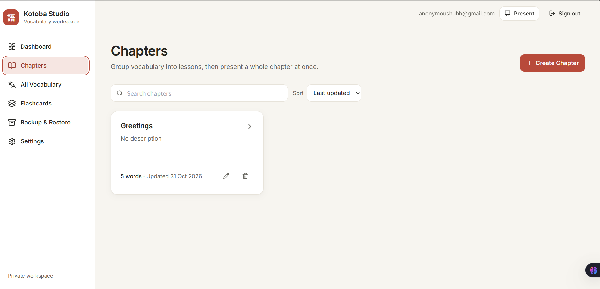
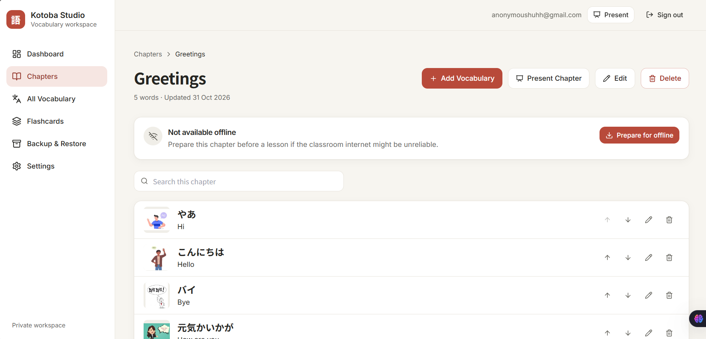
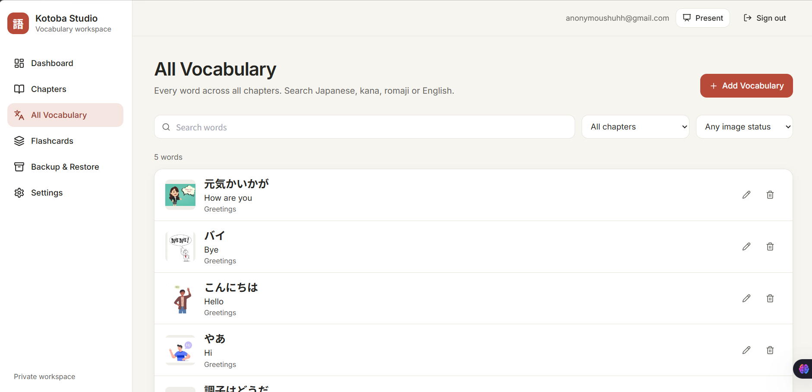
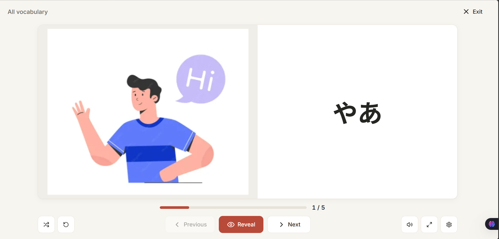

# Kotoba Studio

A private web app for creating Japanese vocabulary flashcards with images, organising them into chapters, and presenting them on a classroom screen.
Web App Link: https://japanese-flashcards-cc49f.web.app/

## Stack
- React, Vite, Tailwind CSS
- Firebase Authentication (Google), Cloud Firestore
- Installable app with offline presentation support

## Getting started
```bash
npm install
npm run dev
```
Fill in `.env` with your Firebase web app values and set up Firebase by following `docs/SETUP_FIREBASE.md`.

## Scripts
| Command | What it does |
|---|---|
| `npm run dev` | Start the development server |
| `npm run build` | Create the production build in `dist` |
| `npm run preview` | Serve the production build locally (needed to test offline mode) |
| `npm run lint` | Check the code with ESLint |
| `npm run deploy` | Build and publish the site and Firestore rules |
| `npm test` | Run the unit tests |
| `npm run test:rules` | Run the Firestore security rules tests (needs Java and the Firebase emulator) |

## Project structure
```
src/
  app/          routing and route protection
  components/   reusable interface components
  features/     auth, backup and offline logic
  hooks/        shared React hooks
  lib/          Firebase setup, validation, constants
  pages/        one file per screen
  services/     all Firestore and storage access
  styles/       global styles
  utils/        small helpers
public/         manifest, icons, service worker
tests/          unit and security rules tests
```


## Screenshots

### Login Page


### Dashboard


### Chapter


### Chapter 2


### Vocabulary


### Flashcards



## Deploying
The site is hosted on Firebase Hosting. In short:
```bash
npx firebase-tools login
npx firebase-tools use <project-id>
npm run deploy
```

## Security
Access is limited to the accounts listed in the `owner/config` Firestore document. The rules in `firestore.rules` enforce this for every read and write.
